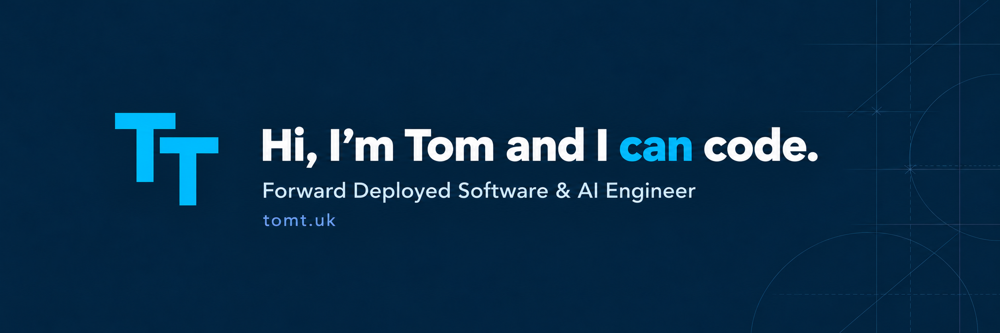

  

<h3 align="center">
  &ldquo;What I cannot create, I do not understand.&rdquo;
</h3>

  RICHARD FEYNMAN

 

<h1 align="center">Hi, I'm Tom 👋</h1>

<strong>Forward Deployed Engineer · Software &amp; AI</strong>

Despite the username, I can code. I've been doing it since 2018, so TomCantCode is getting harder to defend.

  
  
  

 

<table>
  <tr>
    <td width="50%" valign="top">
      <h3>🧠 What Makes Me Tick</h3>
      
Practical AI, useful automation and software that makes someone's day easier. I enjoy taking an open-ended idea all the way from the first conversation to deployment.

    </td>
    <td width="50%" valign="top">
      <h3>⚡ Where It Started</h3>
      
Python sparked my interest in coding; Discord bots taught me APIs, databases and automation. Today, I build across AI systems and full-stack web applications.

    </td>
  </tr>
  <tr>
    <td width="50%" valign="top">
      <h3>🛠️ What I Build</h3>
      
AI agents, automated workflows, web apps and custom Discord bots. I care about the details, from the interface to the infrastructure.

    </td>
    <td width="50%" valign="top">
      <h3>🏁 Away from the Keyboard</h3>
      
Formula 1 fan, live music show regular, and traveller. I once saw my favourite artist live five times in one year.

    </td>
  </tr>
</table>

Much of my client work lives in private repositories. There's more to explore on my portfolio.

 

<h2 align="center">My Technical Toolkit</h2>

From Python automation to AI agents and modern web interfaces.

<h4 align="center">AI &amp; Machine Learning</h4>

  
  
  
  
  
  
  

<h4 align="center">Frontend</h4>

  
  
  
  
  
  
  
  
  

<h4 align="center">Backend &amp; Integration</h4>

  
  
  
  
  
  
  
  

<strong>More Tools</strong> Data, Cloud, Testing &amp; Design

<h4 align="center">Development Tools</h4>

  
  

<h4 align="center">Data</h4>

  
  
  
  
  

<h4 align="center">Cloud &amp; Delivery</h4>

  
  
  
  
  
  

<h4 align="center">Testing &amp; Design</h4>

  
  
  
  

 

<h2 align="center">Always Learning</h2>

  
  
  
  

<a href="https://portfolio.tomt.uk">More about me, my work and my credentials ↗</a>

